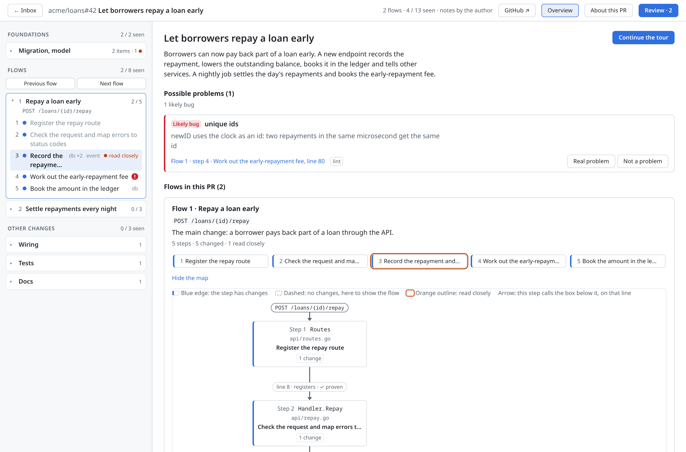
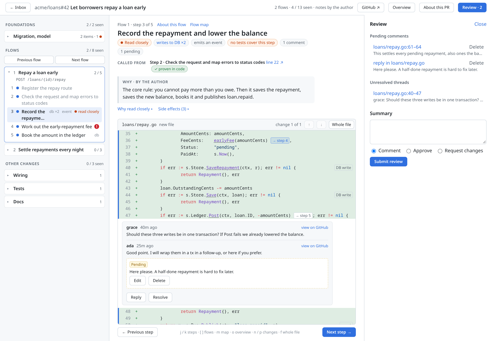
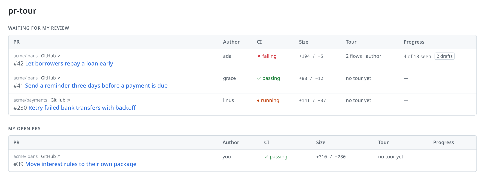

# pr-tour

Review a pull request as a guided tour, in the order the code runs.

A diff shows files in alphabetical order. pr-tour shows the change the way you would
explain it to a colleague. First what it builds on. Then each flow, step by step, from
its entry point: a route, a job or an event handler. A map shows which step calls
which. And you do your GitHub review in the same place.



<sub>All screenshots show a made-up PR in a made-up repo, `acme/loans`.</sub>

## What you get

- **Flows, in the order the code runs.** Each flow starts at its entry point and
  follows the calls, step by step. Every step says why it is there and what it
  touches: database writes, events, calls to other services.
- **A flow map.** A diagram of each flow: which step calls which, and on what line.
- **Any language, and proof for Go.** Claude reads the code, so tours work in any
  language. For Go, pr-tour also parses the code and checks each flow against it.
  Every call it finds in the code is marked **proven**.
- **Your GitHub review, in the tour.** Comment on lines and suggest changes. Reply to
  threads and resolve them. Then submit it all as one review. CI problems and
  review-bot comments show up next to the code they are about.
- **Nothing hidden.** Every changed line has exactly one place in the tour. Lines the
  tour does not explain are listed under "Unexplained".
- **Tours from Claude or from the author.** pr-tour asks the `claude` CLI to build a
  tour. Or the PR's author runs `/tour` right after pushing. Then the notes say _why_
  each change was made.

## Flows and the flow map

The flow map draws each flow as a call tree. A blue edge means the step has changes.
A dashed box has no changes; it is there to show the flow. An orange outline marks a
step to read closely. Each arrow between steps names the line that makes the call.

In Go, a ✓ means the call is in the code: the checker found it. In other languages, an
arrow shows what the tour says. It is drawn dashed and marked "not checked".

<p align="center">
  
</p>

Peek: click a step on the map and read its code below it, without leaving the map.


## A step in the tour

A PR is split into three parts. **Foundations** are what the change builds on:
migrations, models, config and dependencies. **Flows** follow the code from an entry
point. **Other changes** are the rest: refactors, tests, infra and docs.

Each step shows its code with the diff. A note says why, written by the author or by
Claude. A line says which step called it. Calls that lead to another step get a
**→ step N** badge. Click the call to go to that step. Side effects, like database
writes, are marked on their line. A step with no test says so.



## Works with GitHub

- **Inbox.** PRs waiting for your review and your own open PRs, with CI status, tour
  progress and unsent drafts.
- **Threads.** Existing review threads show up next to their lines. Reply to them,
  resolve them or unresolve them.
- **Drafts.** Comments stay on your machine until you submit them as one review. If
  you approve while some steps are not seen yet, pr-tour lists them first.
- **Possible problems.** Failed CI checks, CI notes on changed lines, and open comments
  from review bots (CodeRabbit, Copilot and others) are listed on the overview. Each
  one is pinned to the step it is about. Mark each one as a real problem or not.
- **Your own login.** pr-tour talks to GitHub with your `gh` login. It never pushes to a
  PR.



pr-tour runs on your machine only. It listens on 127.0.0.1. It posts to GitHub only
when you submit a review, or resolve or unresolve a thread. When Claude builds a tour,
it can only read files. Hooks and settings in the PR's code do not run.

## Requirements

- Node 22 or later
- [`gh`](https://cli.github.com/), logged in (`gh auth status`)
- The [`claude`](https://docs.anthropic.com/en/docs/claude-code) CLI, logged in (for inferred tours)
- `git`
- Go 1.26 or later (optional, for the code check)

## Install

```sh
git clone <this repo> && cd pr-tour
npm install
npm run build
npm i -g .
```

This puts `pr-tour` on your PATH.

### Install the `/tour` skill

```sh
cp -r skill/tour ~/.claude/skills/
```

## Usage

```sh
pr-tour                         # run pr-tour in this terminal and open the inbox (Ctrl-C stops it)
pr-tour open owner/name#123     # open the tour of one PR
```

`pr-tour open` uses the pr-tour that is already running. If none is running, it
starts one in the background, waits until it answers, opens the browser and
exits. That background pr-tour keeps running. It prints its pid. Its output goes to
`server.log` in the data dir (`~/.pr-tour/server.log` by default).
Stop it with `kill <pid>`.

Open a PR from the inbox and click **Build tour**. While the tour builds, pr-tour
shows what Claude is doing and how long it has run. In the tour:

| Key       | Does                                              |
| --------- | ------------------------------------------------- |
| `j` / `k` | next / previous step in the tour                  |
| `[` / `]` | previous / next flow                              |
| `n` / `p` | next / previous change                            |
| `o`       | open or close the overview                        |
| `m`       | show or hide the flow map of this flow            |
| `f`       | show the whole file, or fold unchanged code again |
| `Esc`     | close the peek, the map or the overview           |

Seen marks are saved, so you can stop and come back.

### Code check

Tours work in any language, because Claude reads the code and writes the flows. In
most languages, pr-tour does not parse the code. So nothing checks the flows: they are
what Claude (or the author) says. The flow map draws their arrows dashed.

For Go, pr-tour goes further. A checker parses the code with Go's own tools. It finds
the function behind each step and the calls between steps. Each call it finds is
marked **proven**. Steps that do not match the code are reported (`finding:` lines in
`pr-tour import`). **About this PR** shows how many steps sit on their function and
how many calls were proven. The checker never downloads
anything: it loads the project with `GOPROXY=off`.

This needs Go 1.26 or later. It is optional. `npm run build` builds the checker when
it finds a suitable `go`, and prints one line and goes on when it does not. Without
it, tours still build. To check a tour again, run `pr-tour recheck owner/name#123`.
`pr-tour functions owner/name#123` lists the functions in a PR.

pr-tour runs the checker built at `dist/bin/pr-tour-check-go`. Set `PR_TOUR_CHECKER`
to the path of another checker binary to use that one instead. The override wins.
If the file it names is not executable, the check does not run. The tour then says the
checker is not installed. pr-tour does not fall back to the built one.

### Reviewing

You can do your GitHub review inside the tour.

- **Comment:** click a line number in the code view. To pick a range, drag over
  the line numbers or Shift-click a second line. Type your comment and save it.
- **Suggest:** on new lines inside the diff, click **Suggest change**. You get a
  `suggestion` block to edit.
- **Lines outside the diff:** GitHub can't take a line comment there. pr-tour
  says so before you save. The comment is sent as a file-level comment that
  quotes the lines. The same goes for a range that spans two hunks.
- **Threads:** existing review threads show up next to their lines. You can
  reply to them. You can resolve or unresolve them; that goes to GitHub right
  away.

Comments and replies are **drafts**. They stay on your machine until you
submit. You can edit or delete them first.

Open the **Review** panel to submit. Write a summary if you want. Pick
**Comment**, **Approve** or **Request changes**, then click **Submit review**.
pr-tour sends all your drafts and the summary as one GitHub review, on the
commit the tour was built for. If any part fails, nothing is posted: the review
is taken back and your drafts stay. If you approve while some tour items are
not seen yet, pr-tour lists them first. You can still approve.

On your own PR you can only **Comment**. GitHub does not let you approve or
request changes on your own PR.

**Drafts on an older version.** When the PR gets new commits and you rebuild the
tour, your drafts stay. Drafts made on the older version may not match the new
lines. So they are sent as file-level comments that quote the lines you picked.

**Replacing a tour with drafts.** If a PR has unsent drafts, pr-tour asks before
it replaces the tour. In the web app you confirm with a button. With
`pr-tour import`, add `--replace`. Without it, `import` prints a warning and
stops (exit code 2).

### Author tours with `/tour`

After you push a PR, run `/tour` in the Claude Code session where you made the
change. Claude writes the tour from what it knows about why each change was
made, checks it with `pr-tour import`, and opens it. The tour says
"notes by the author".

The skill uses these commands, which you can also run yourself:

```sh
pr-tour schema    # the JSON Schema of a tour file
pr-tour rules     # the rules a tour file follows
pr-tour import --repo owner/name --pr 123 --file tour.json
```

`import` prints a `problem: ...` line for each home that is wrong (overlapping, or
pointing at nothing changed) and an `unexplained: ...` line for each run of changed
lines that has no home. No output besides the URL means every changed line has
exactly one home.

### Settings

| Variable          | Default      | Meaning                                |
| ----------------- | ------------ | -------------------------------------- |
| `PR_TOUR_PORT`    | `4317`       | port to listen on                      |
| `PR_TOUR_HOME`    | `~/.pr-tour` | data dir (clones, tours, seen, drafts) |
| `PR_TOUR_NO_OPEN` | unset        | set to `1` to not open a browser       |
| `PR_TOUR_CHECKER` | unset        | path of the Go checker binary to use   |

## Development

Read [`docs/architecture.md`](docs/architecture.md) first: layers, import rules,
testing and naming.

```sh
npm run dev      # API server + Vite with hot reload
npm run check    # typecheck, lint, format check and tests; run before every commit
```
