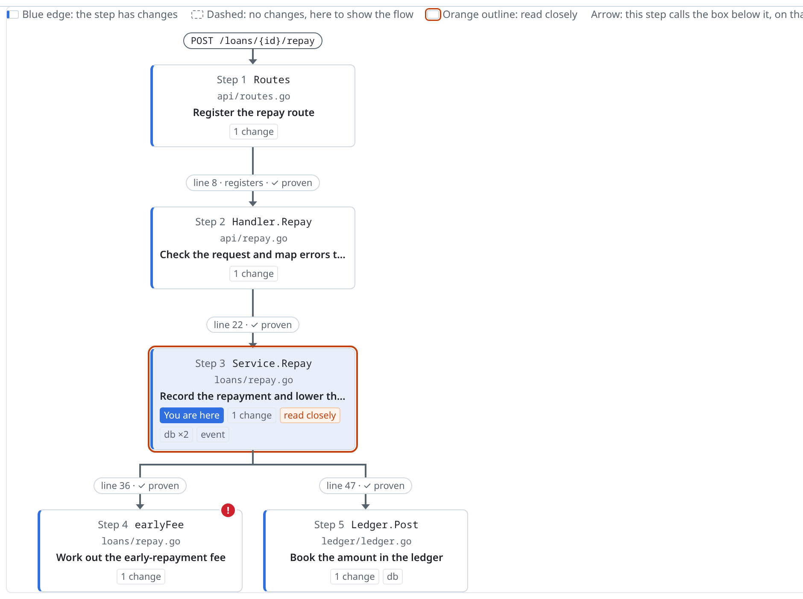
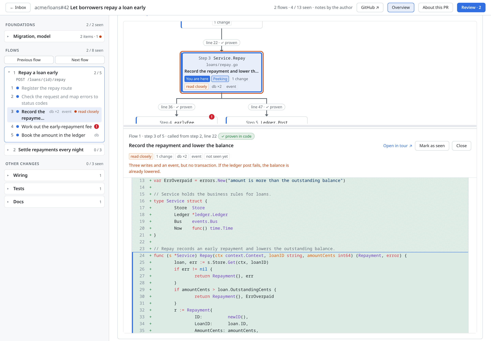

# pr-tour

Review a pull request as a guided tour, in the order the code runs.

A diff shows files in alphabetical order. pr-tour shows the change the way you
would explain it to a colleague: what it builds on, then each flow from its entry
point (a route, a job, an event handler) step by step, with a map of who calls whom.
You do your GitHub review in the same place.


<sub>All screenshots show a made-up PR in a made-up repo, `acme/loans`.</sub>

## What you get

- **Flows, in the order the code runs.** Each flow starts at its entry point and
  follows the calls, step by step. Every step says why it changed and what it touches:
  database writes, events, calls to other services.
- **A flow map.** A diagram of each flow: which step calls which, and on what line.
  For Go code, pr-tour checks every arrow against the real code and marks it
  **proven**.
- **Nothing hidden.** Every changed line has exactly one place in the tour. Lines the
  tour does not explain are listed under "Unexplained".
- **Your GitHub review, in the tour.** Comment on lines, suggest changes, reply to and
  resolve threads, then submit one review. CI failures and review-bot findings show up
  next to the code they are about.
- **Tours from Claude or from the author.** pr-tour asks the `claude` CLI to build a
  tour. Or the PR's author runs `/tour` right after pushing, and the notes say _why_
  each change was made.

## Flows and the flow map

A PR is split in three parts. **Foundations** are what the change builds on:
migrations, models, config and dependencies. **Flows** follow the code from an entry
point. **Other changes** are the rest: refactors, tests, infra and docs.

The flow map draws each flow as a call tree. A blue edge means the step has changes.
An orange outline means: read this one closely. Each arrow names the line that makes
the call, and says if the code check proved it.



Click a step on the map to peek into its code without leaving the map.



## A step in the tour

Each step shows its code with the diff, the author's (or Claude's) note on why, and
where the flow came from. Calls that lead to another step get a **→ step N** badge, so
you can follow the flow in the code. Side effects, like database writes, are marked
on their line.


## Works with GitHub

- **Inbox.** PRs waiting for your review and your own open PRs, with CI status, tour
  progress and unsent drafts.
- **Threads.** Existing review threads show up next to their lines. Reply, resolve or
  unresolve them.
- **Drafts.** Comments stay on your machine until you submit them as one review.
- **Possible problems.** Failed CI checks and their line notes are listed on the
  overview and pinned to the step they belong to. Mark each one as a real problem or not.
- **Your own login.** pr-tour talks to GitHub with your `gh` login. It never pushes to a
  PR.


pr-tour runs on your machine only. It listens on 127.0.0.1. It posts to GitHub only
when you submit a review or resolve a thread.

## Requirements

- Node 22 or later
- [`gh`](https://cli.github.com/), logged in (`gh auth status`)
- The [`claude`](https://docs.anthropic.com/en/docs/claude-code) CLI, logged in (for inferred tours)
- `git`

## Install

```sh
git clone <this repo> && cd pr-tour
npm install
npm run build
npm i -g .
```

This puts `pr-tour` on your PATH.

### Install the `/tour` skill

```sh
cp -r skill/tour ~/.claude/skills/
```

## Usage

```sh
pr-tour                         # run pr-tour in this terminal and open the inbox (Ctrl-C stops it)
pr-tour open owner/name#123     # open the tour of one PR
```

`pr-tour open` uses the pr-tour that is already running. If none is running, it
starts one in the background, waits until it answers, opens the browser and
exits. That background pr-tour keeps running; it prints its pid and writes its
output to `server.log` in the data dir (`~/.pr-tour/server.log` by default).
Stop it with `kill <pid>`.

The inbox lists PRs waiting for your review and your own open PRs. Open one and
click **Build tour** to get an inferred tour. In the tour:

| Key       | Does                                              |
| --------- | ------------------------------------------------- |
| `j` / `k` | next / previous step in the tour                  |
| `[` / `]` | previous / next flow                              |
| `n` / `p` | next / previous change                            |
| `o`       | open or close the overview                        |
| `m`       | show or hide the flow map of this flow            |
| `f`       | show the whole file, or fold unchanged code again |

Seen marks are saved, so you can stop and come back.

The inbox also shows each PR's CI status and how many unsent drafts it has.

### Code check

pr-tour can check a tour against the code. For Go files it adds the real functions
and calls to the tour, and it reports steps that do not match the code
(`finding:` lines in `pr-tour import`).

This needs Go 1.26 or later. It is optional. `npm run build` builds the checker when
it finds a suitable `go`, and prints one line and goes on when it does not. Without
it, tours still build. To check a tour again, run `pr-tour recheck owner/name#123`.
`pr-tour functions owner/name#123` lists the functions in a PR.

pr-tour runs the checker built at `dist/bin/pr-tour-check-go`. Set `PR_TOUR_CHECKER`
to the path of another checker binary to use that one instead. The override wins: if
the file it names is not executable, the check does not run (and the tour says the
checker is not installed). pr-tour does not fall back to the built one.

### Reviewing

You can do your GitHub review inside the tour.

- **Comment:** click a line number in the code view. Shift-click a second line
  to pick a range. Type your comment and save it.
- **Suggest:** on new lines inside the diff, click **Suggest change**. You get a
  `suggestion` block to edit.
- **Lines outside the diff:** GitHub can't take a line comment there. pr-tour
  says so before you save. The comment is sent as a file-level comment that
  quotes the lines. The same goes for a range that spans two hunks.
- **Threads:** existing review threads show up next to their lines. You can
  reply to them. You can resolve or unresolve them; that goes to GitHub right
  away.

Comments and replies are **drafts**. They stay on your machine until you
submit. You can edit or delete them first.

Open the **Review** panel to submit. Write a summary if you want. Pick
**Comment**, **Approve** or **Request changes**, then click **Submit review**.
pr-tour sends all your drafts and the summary as one GitHub review, on the
commit the tour was built for. If any part fails, nothing is posted: the review
is taken back and your drafts stay. If you approve while some tour items are
not seen yet, pr-tour lists them first. You can still approve.

On your own PR you can only **Comment**. GitHub does not let you approve or
request changes on your own PR.

**Drafts on an older version.** When the PR gets new commits and you rebuild the
tour, your drafts stay. Drafts made on the older version may not match the new
lines. So they are sent as file-level comments that quote the lines you picked.

**Replacing a tour with drafts.** If a PR has unsent drafts, pr-tour asks before
it replaces the tour. In the web app you confirm with a button. With
`pr-tour import`, add `--replace`. Without it, `import` prints a warning and
stops (exit code 2).

### Author tours with `/tour`

After you push a PR, run `/tour` in the Claude Code session where you made the
change. Claude writes the tour from what it knows about why each change was
made, checks it with `pr-tour import`, and opens it. The tour is labeled
"Notes by the author".

The skill uses these commands, which you can also run yourself:

```sh
pr-tour schema    # the JSON Schema of a tour file
pr-tour rules     # the rules a tour file follows
pr-tour import --repo owner/name --pr 123 --file tour.json
```

`import` prints a `problem: ...` line for each home that is wrong (overlapping, or
pointing at nothing changed) and an `unexplained: ...` line for each run of changed
lines that has no home. No output besides the URL means every changed line has
exactly one home.

### Settings

| Variable          | Default      | Meaning                                |
| ----------------- | ------------ | -------------------------------------- |
| `PR_TOUR_PORT`    | `4317`       | port to listen on                      |
| `PR_TOUR_HOME`    | `~/.pr-tour` | data dir (clones, tours, seen, drafts) |
| `PR_TOUR_NO_OPEN` | unset        | set to `1` to not open a browser       |
| `PR_TOUR_CHECKER` | unset        | path of the Go checker binary to use   |

## Development

Read [`docs/architecture.md`](docs/architecture.md) first: layers, import rules,
testing and naming.

```sh
npm run dev      # API server + Vite with hot reload
npm run check    # typecheck, lint, format check and tests; run before every commit
```
